# Configuración del laboratorio de Proxmox y Kubernetes

Este documento registra la instalación y validación de un entorno pequeño de
Kubernetes alojado en Proxmox VE.

# Grupo 8 — KubeLab

## Inventario de red, infraestructura y servicios de Kubernetes

> **Fuente:** salidas verificadas con `k3s kubectl get nodes`, `get svc -A -o wide`, `get pods -A -o wide`, `get pvc -A`, `get ingressroute -A` y `get ingress -A`, más las direcciones de la infraestructura confirmadas durante la práctica. Las IP de los pods representan una captura puntual y pueden cambiar si se recrean.

### 1. Infraestructura física y red local

| Elemento | Identificador | Dirección IPv4 | Red / máscara | Función |
|---|---|---|---|---|
| Laptop Windows (ICS) | Interfaz Ethernet compartida | `192.168.137.1` | `192.168.137.0/24` | Puerta de enlace, NAT y acceso a Internet para Proxmox y las VMs |
| Host Proxmox VE | Hipervisor físico | `192.168.137.2` | `192.168.137.0/24` | Alojamiento de las máquinas virtuales |
| VM101 — Control Plane | `k8s-control` | `192.168.137.159` | `192.168.137.0/24` | Servidor k3s y administración de Kubernetes |
| VM102 — Worker 1 | `k8s-worker1` | `192.168.137.47` | `192.168.137.0/24` | Ejecución de cargas de trabajo |
| MetalLB / Traefik | IP externa del Service `traefik` | `192.168.137.240` | `192.168.137.0/24` | Punto de entrada HTTP/HTTPS al clúster |
| Wi-Fi de Windows | Conexión ascendente | Asignada por DHCP | Variable según Wi-Fi u hotspot | Salida a Internet de Windows, compartida por ICS |

**Parámetros de infraestructura:** red `192.168.137.0/24`; gateway `192.168.137.1`; hipervisor `192.168.137.2`; nodos con IP estática `192.168.137.159` y `192.168.137.47`; dirección LoadBalancer `192.168.137.240`.

### 2. Red de Kubernetes y CNI

| Componente | Dirección o rango | Alcance / observación |
|---|---|---|
| Red de nodos | `192.168.137.0/24` | Comunicación entre host y VMs |
| Pod CIDR del Control Plane | `10.42.0.0/24` | Asignado a `k8s-control` |
| Pod CIDR del Worker 1 | `10.42.1.0/24` | Asignado a `k8s-worker1` |
| Espacio de direcciones de pods | `10.42.x.x` | Observado en las IP de pods |
| Espacio de servicios ClusterIP | `10.43.x.x` | Observado en los Services |
| DNS de Kubernetes (CoreDNS) | `10.43.0.10` | Puerto `53/UDP` y `53/TCP` |
| Servicio de la API de Kubernetes | `10.43.0.1` | Puerto `443/TCP` |
| LoadBalancer de Traefik | `192.168.137.240` | Puertos externos `80/TCP` y `443/TCP` |

### 3. Direccionamiento de Services

| Namespace | Service | Tipo | ClusterIP | IP externa | Puertos |
|---|---|---|---|---|---|
| `argocd` | `argocd-applicationset-controller` | ClusterIP | `10.43.164.248` | — | `7000/TCP` |
| `argocd` | `argocd-redis` | ClusterIP | `10.43.137.29` | — | `6379/TCP` |
| `argocd` | `argocd-repo-server` | ClusterIP | `10.43.111.136` | — | `8081/TCP` |
| `argocd` | `argocd-server` | ClusterIP | `10.43.231.31` | — | `80/TCP`, `443/TCP` |
| `default` | `kubernetes` | ClusterIP | `10.43.0.1` | — | `443/TCP` |
| `kube-system` | `kube-dns` | ClusterIP | `10.43.0.10` | — | `53/UDP`, `53/TCP`, `9153/TCP` |
| `kube-system` | `metrics-server` | ClusterIP | `10.43.230.197` | — | `443/TCP` |
| `kube-system` | `traefik` | LoadBalancer | `10.43.14.170` | `192.168.137.240` | `80:32464/TCP`, `443:30888/TCP` |
| `kubelab` | `kubelab-api` | ClusterIP | `10.43.203.232` | — | `80/TCP` |
| `kubelab` | `kubelab-web` | ClusterIP | `10.43.235.164` | — | `80/TCP` |
| `kubelab` | `postgresql` | Headless (`ClusterIP: None`) | — | — | `5432/TCP` |
| `metallb-system` | `metallb-webhook-service` | ClusterIP | `10.43.222.21` | — | `443/TCP` |
| `monitoring` | `grafana` | ClusterIP | `10.43.120.215` | — | `80/TCP` |
| `monitoring` | `loki` | ClusterIP | `10.43.113.2` | — | `3100/TCP` |
| `monitoring` | `prometheus-server` | ClusterIP | `10.43.20.109` | — | `80/TCP` |

> PostgreSQL utiliza un Service **headless**: no tiene una ClusterIP virtual. Su DNS interno puede resolver directamente las IP de los endpoints asociados.

### 4. Direcciones DNS internas de servicios principales

| Componente | Dirección dentro de Kubernetes | Puerto |
|---|---|---|
| Frontend | `kubelab-web.kubelab.svc.cluster.local` | `80` |
| API REST | `kubelab-api.kubelab.svc.cluster.local` | `80` |
| PostgreSQL | `postgresql.kubelab.svc.cluster.local` | `5432` |
| Grafana | `grafana.monitoring.svc.cluster.local` | `80` |
| Prometheus | `prometheus-server.monitoring.svc.cluster.local` | `80` |
| Loki | `loki.monitoring.svc.cluster.local` | `3100` |
| Argo CD | `argocd-server.argocd.svc.cluster.local` | `80`, `443` |
| Traefik | `traefik.kube-system.svc.cluster.local` | `80`, `443` |
| CoreDNS | `kube-dns.kube-system.svc.cluster.local` | `53` |

### 5. IP y ubicación de pods

| Namespace | Pod | IP registrada | Nodo | Estado observado |
|---|---|---|---|---|
| `argocd` | `argocd-application-controller-0` | `10.42.1.41` | `k8s-worker1` | Running |
| `argocd` | `argocd-applicationset-controller-74887bfd8f-9lfkg` | `10.42.1.36` | `k8s-worker1` | Running |
| `argocd` | `argocd-redis-85d66966f9-544r8` | `10.42.1.38` | `k8s-worker1` | Running |
| `argocd` | `argocd-repo-server-668df84947-l2s7r` | `10.42.1.42` | `k8s-worker1` | Running |
| `argocd` | `argocd-server-57fd8796b8-qtldc` | `10.42.1.37` | `k8s-worker1` | Running |
| `default` | `kubelab-storage-test-7ccbd46fcd-xh6jf` | `10.42.1.39` | `k8s-worker1` | Running |
| `doppler-operator-system` | `doppler-operator-controller-manager-5cc574c984-chw9d` | `10.42.0.58` | `k8s-control` | Running |
| `kube-system` | `coredns-7cfb7bc9c7-wf6j2` | `10.42.0.62` | `k8s-control` | Running |
| `kube-system` | `helm-install-traefik-crd-vf6vb` | — | `k8s-control` | Completed |
| `kube-system` | `helm-install-traefik-rwmwq` | — | `k8s-control` | Completed |
| `kube-system` | `local-path-provisioner-77b9867795-qhkcz` | `10.42.0.63` | `k8s-control` | Running |
| `kube-system` | `metrics-server-6dc596dfb8-d8r6p` | `10.42.0.61` | `k8s-control` | Running |
| `kube-system` | `svclb-traefik-e90f165b-l7j48` | `10.42.0.60` | `k8s-control` | Running (2/2) |
| `kube-system` | `svclb-traefik-e90f165b-xrl8v` | `10.42.1.35` | `k8s-worker1` | Running (2/2) |
| `kube-system` | `traefik-7c8544f77-mv8gv` | `10.42.0.59` | `k8s-control` | Running |
| `kubelab` | `kubelab-api-5d8744685f-2mcf8` | `10.42.1.33` | `k8s-worker1` | Running |
| `kubelab` | `kubelab-web-676d6dcd6c-pps4l` | `10.42.1.40` | `k8s-worker1` | Running |
| `kubelab` | `postgresql-0` | `10.42.1.34` | `k8s-worker1` | Running |
| `metallb-system` | `controller-658745d67-srdcn` | `10.42.0.64` | `k8s-control` | Running |
| `metallb-system` | `speaker-bdsw9` | `192.168.137.47` | `k8s-worker1` | Running (IP del nodo) |
| `metallb-system` | `speaker-qrh6k` | `192.168.137.159` | `k8s-control` | Running (IP del nodo) |
| `monitoring` | `alloy-54f4898cdd-tr9w7` | `10.42.1.45` | `k8s-worker1` | Running |
| `monitoring` | `grafana-7b6444755c-7kmw2` | `10.42.0.68` | `k8s-control` | Running |
| `monitoring` | `loki-78c6c7f495-gnfzt` | `10.42.1.44` | `k8s-worker1` | Running |
| `monitoring` | `prometheus-server-8d76cfd5d-dc547` | `10.42.0.65` | `k8s-control` | Running (2/2; con reinicios registrados) |

> Los `speaker` de MetalLB aparecen con IP de nodo; no se les asignó en esta captura una dirección de la red `10.42.x.x`. Los Jobs de instalación de Traefik aparecen como **Completed**, que es su estado esperado.

### 6. Almacenamiento persistente (PVC)

| Namespace | PVC | Capacidad | Acceso | StorageClass | Estado | PV asociado |
|---|---|---|---|---|---|---|
| `default` | `kubelab-storage-test` | `1Gi` | RWO | `local-path` | Bound | `pvc-87fcb996-6dd3-45e3-a9ce-77aac052c68c` |
| `kubelab` | `postgres-data-postgresql-0` | `2Gi` | RWO | `local-path` | Bound | `pvc-daff0bae-fe60-4714-bee4-a14fb2cc89a6` |
| `monitoring` | `grafana` | `1Gi` | RWO | `local-path` | Bound | `pvc-fe6b4249-2675-4fa5-9327-7a5efcc8cf28` |
| `monitoring` | `loki-data` | `2Gi` | RWO | `local-path` | Bound | `pvc-0070a4ee-500e-4554-ac10-5e049eca83ff` |
| `monitoring` | `prometheus-server` | `2Gi` | RWO | `local-path` | Bound | `pvc-617f56ae-9dfa-400b-a035-e0fcba336856` |
| **Total** | **5 PVC** | **8Gi** | — | `local-path` | **5 Bound** | — |

### 7. Enrutamiento y dominios realmente utilizados

| Namespace | Recurso | Observación |
|---|---|---|
| `kubelab` | `IngressRoute/kubelab-api` | Ruta Traefik del backend |
| `kubelab` | `IngressRoute/kubelab-web` | Ruta Traefik del frontend |
| `monitoring` | `IngressRoute/grafana` | Ruta Traefik de Grafana |

### 8. Observaciones de operación

- El clúster está formado por **un Control Plane y un Worker**, ambos registrados como `Ready` en las comprobaciones previas.
- El frontend cuenta con HPA configurado de **1 a 2 réplicas**; durante la prueba se observaron eventos de escalado automático `1 → 2 → 1` motivados por métricas de CPU.
- Se comprobó la continuidad de la infraestructura al cambiar la conexión ascendente de Windows desde Wi-Fi doméstico a un hotspot celular, manteniendo ICS y las IP estáticas internas.

# Pasos realizados

## 1. Instalación de Proxmox VE

El resumen del instalador de Proxmox VE confirma el disco de destino, el
sistema de archivos, la configuración regional, la zona horaria, la interfaz
de administración, el nombre del host, la dirección IP estática, la puerta de
enlace y el DNS antes de iniciar la instalación. El reinicio automático está
habilitado para que el host se reinicie cuando finalice la instalación.

Después de la instalación, la consola de Proxmox muestra la URL de
administración. Esta consola confirma que el host se inició correctamente y
está listo para administrarse mediante la interfaz web.

## 2. Configuración de red de Proxmox

Los comandos `ip -br link` e `ip -br addr` muestran el estado de las
interfaces del host. La interfaz física está conectada al puente de Proxmox y
el puente tiene la dirección IPv4 del host. Esto verifica que el host cuenta
con conectividad de red para la administración y las máquinas virtuales.

## 3. Interfaz web de Proxmox y almacenamiento de máquinas virtuales

La interfaz web de Proxmox proporciona la vista central de administración del
datacenter. Muestra el nodo de Proxmox, el puente de red, los almacenes y el
uso actual de recursos, lo que confirma que el host está visible y puede
administrarse.

La vista de almacenamiento muestra el almacén `local` y su capacidad
disponible. También muestra la máquina virtual del control plane y registra
tareas recientes, como la creación de la máquina virtual, la copia de datos y
su inicio.

## 4. Máquina virtual del control plane

La consola del control plane muestra Debian GNU/Linux 13 ejecutándose en la
máquina virtual `k8s-control`. El inicio de sesión correcto y el indicador de
comandos confirman que el sistema operativo está instalado y que la máquina
virtual es accesible desde la consola de Proxmox.

### 4.1 Conectividad del control plane

La terminal del control plane muestra primero la información de red del
nodo y después ejecuta `apt update`. Las respuestas correctas de los
repositorios y el resultado final actualizado verifican que la máquina virtual
puede acceder a los repositorios de paquetes de Debian.

### 4.2 Servicios de Kubernetes del control plane

Las métricas del control plane muestran las cargas de trabajo de Kubernetes
ejecutándose en el espacio de nombres `kube-system`, incluidos CoreDNS, el
servidor de métricas, el provisionador de rutas locales y Traefik. La salida
también muestra la dirección IPv4 del nodo y las interfaces Flannel y CNI
utilizadas para la red de los pods.

## 5. Máquina virtual Worker 1

La consola de Worker 1 muestra Debian GNU/Linux 13 ejecutándose en la máquina
virtual `k8s-worker1`. El inicio de sesión correcto y el indicador de comandos
confirman que el sistema operativo del worker está disponible para configurarlo
con Kubernetes.

### 5.1 Conectividad de red de Worker 1

La terminal del worker utiliza `ping google.com` para probar la conectividad
externa. El comando resuelve el nombre de host y comienza a recibir
respuestas ICMP, lo que confirma que Worker 1 puede acceder a la red.

### 5.2 Instalación de Kubernetes en Worker 1

La salida del estado de Kubernetes muestra el nodo del control plane en
estado `Ready` y los pods del sistema de Kubernetes ejecutándose en Worker 1.
La salida también muestra la dirección IPv4 interna del worker, la interfaz
Flannel y la interfaz CNI, lo que confirma que el nodo se unió al clúster y
que tiene configurada la red de pods.

## 6. Memoria del host y asignación de máquinas virtuales

La salida de los comandos `free -h`, `swapon --show` y `qm list` valida la
asignación de recursos del host desde la línea de comandos. Muestra la memoria
total y disponible, el espacio swap activo y las cuatro máquinas virtuales en
ejecución, junto con la memoria y el tamaño de disco de arranque asignados.

## 7. Validación final de los cuatro nodos

El árbol de nodos de Proxmox confirma que la máquina virtual del plano de
control y las tres máquinas virtuales worker están ejecutándose
simultáneamente. Esta es la comprobación final de la infraestructura antes de
utilizar el clúster de Kubernetes.

### 7.1 Servicios de k3s y Traefik

La lista de servicios de k3s confirma que los componentes principales del
clúster están activos. También muestra el servicio Traefik, que proporciona
la entrada de tráfico HTTP y HTTPS hacia las aplicaciones desplegadas.

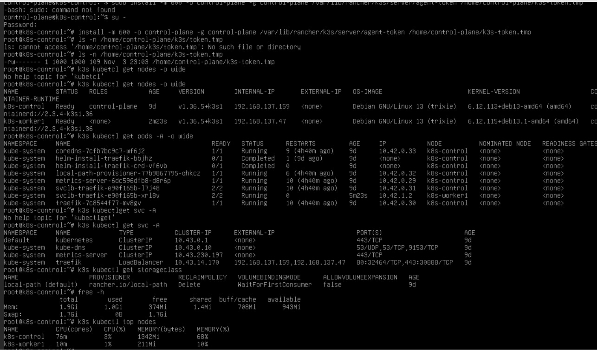

### 7.2 Recursos administrados por Helm

La salida de Helm muestra los recursos instalados y administrados mediante
releases. Esta comprobación confirma que las aplicaciones y sus componentes
asociados fueron desplegados correctamente en el clúster.

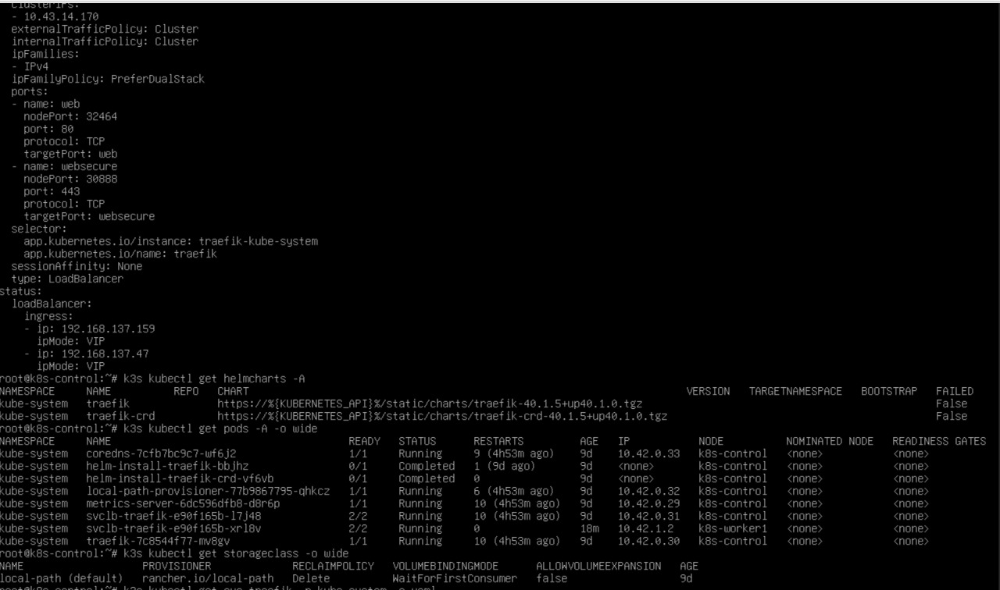

### 7.3 Verificación de taints

La verificación de taints muestra las restricciones configuradas en los nodos
de Kubernetes. Esto permite confirmar qué nodos pueden recibir determinados
pods y que las reglas de programación del clúster están aplicadas.

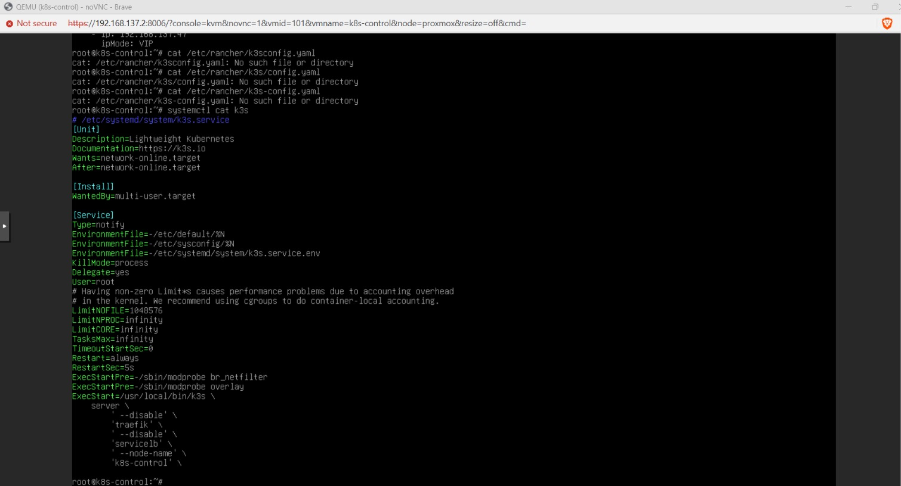

### 7.4 Instalación de Argo CD

La salida de la instalación de Argo CD confirma que sus recursos fueron
creados correctamente en el clúster de Kubernetes. Esta herramienta permite
gestionar las aplicaciones mediante un enfoque de entrega continua basado en
GitOps.

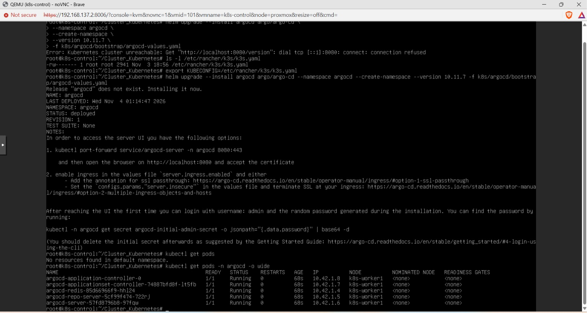

### 7.5 Aplicación de MetalLB

La captura muestra la aplicación de MetalLB desplegada en el clúster de
Kubernetes. MetalLB proporciona balanceo de carga para exponer servicios con
direcciones IP accesibles desde la red local.

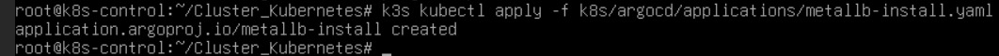

### 7.6 Configuración funcional de MetalLB

La captura confirma que la configuración de MetalLB se encuentra funcionando
correctamente. La asignación de direcciones IP permite que los servicios
publicados mediante `LoadBalancer` sean accesibles desde la red configurada.

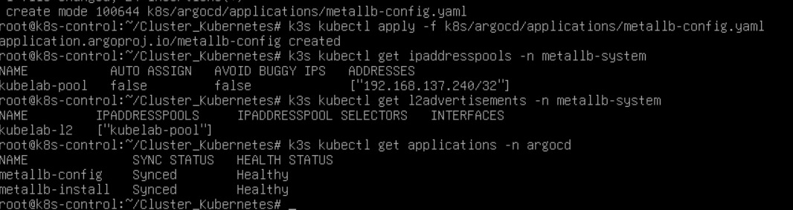

### 7.7 Aplicación de Traefik

La captura muestra la aplicación de Traefik desplegada correctamente en el
clúster. Este componente administra el enrutamiento del tráfico entrante
hacia los servicios publicados por Kubernetes.

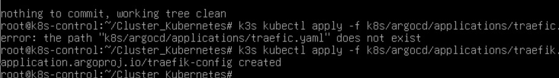

### 7.8 Evidencia de persistencia de datos

La evidencia confirma que los datos de la aplicación permanecen disponibles
después de las operaciones realizadas sobre el pod. Esto demuestra que el
almacenamiento persistente está funcionando correctamente.

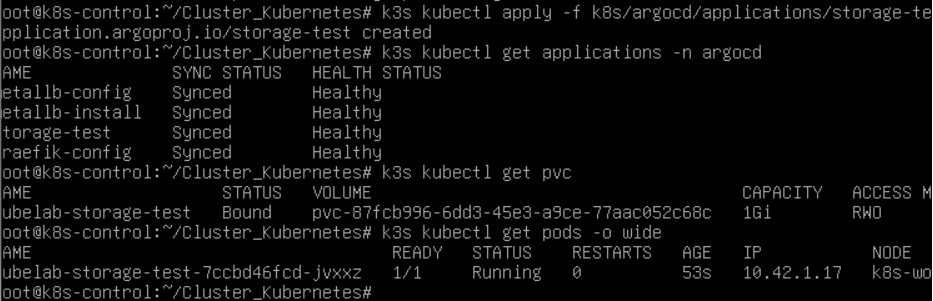

### 7.9 Despliegue de la StorageClass

La captura muestra la creación y configuración de la `StorageClass` utilizada
por Kubernetes para aprovisionar almacenamiento persistente. Esta configuración
permite que las aplicaciones soliciten volúmenes según sus necesidades.

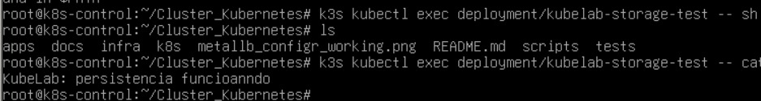

### 7.10 Prueba de eliminación del pod

La prueba muestra la eliminación controlada de un pod para verificar el
comportamiento de recuperación de la aplicación. Esta operación permite
comprobar que Kubernetes puede detectar y gestionar la ausencia del pod.

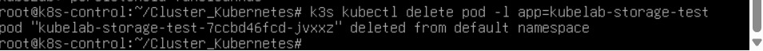

### 7.11 Recreación del pod y recuperación de datos

La captura muestra la recreación del pod y la recuperación de los datos
previamente almacenados. El resultado confirma que la aplicación conserva la
información mediante el volumen persistente después de reiniciarse.

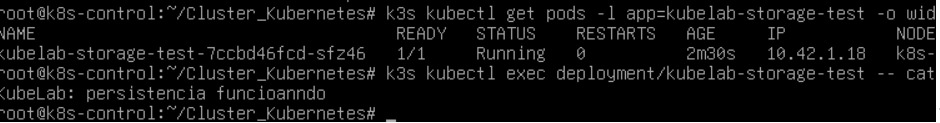

## 8. Gestión segura de secretos con Doppler

### 8.0 Dashboard de Doppler

La captura muestra el Dashboard de Doppler con los secretos, sin revelar, que gestiona, para el proyecto.

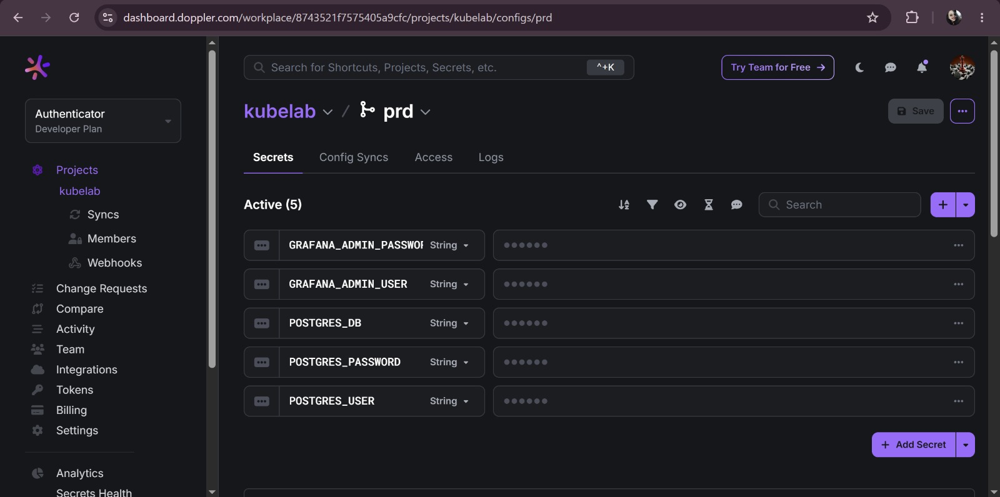

### 8.1 Aplicación de Doppler

La captura muestra Doppler aplicado en el clúster de Kubernetes. Esta
integración permite administrar los secretos de las aplicaciones desde una
fuente centralizada y evitar su almacenamiento directo en los manifiestos.

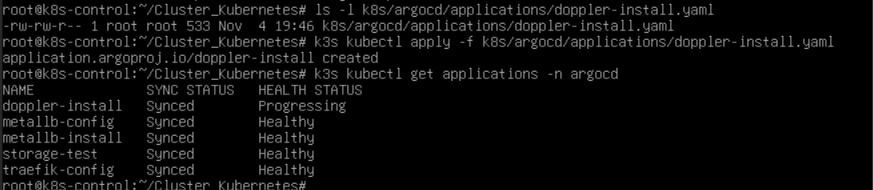

### 8.2 Secretos administrados por Doppler

La vista de Doppler muestra los secretos configurados para el proyecto. Esto
confirma que las credenciales necesarias están disponibles en el gestor de
secretos para ser utilizadas por las aplicaciones autorizadas.

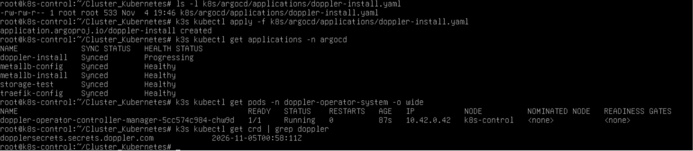

### 8.3 Namespace de secretos

La captura confirma la existencia del namespace destinado a los secretos de
la aplicación. Separar estos recursos facilita su administración y limita el
alcance de los componentes que pueden acceder a ellos.

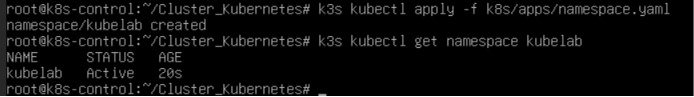

### 8.4 Creación del token de Doppler

La salida muestra la creación del token utilizado para conectar Kubernetes
con Doppler. Este token permite sincronizar los secretos de forma controlada
sin exponer las credenciales directamente en los archivos de configuración.

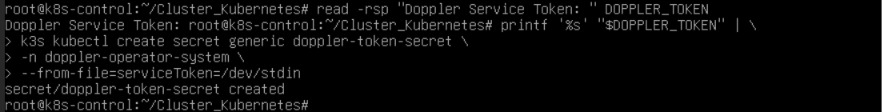

### 8.5 Deshabilitación de credenciales anteriores

La captura evidencia que la credencial anterior fue deshabilitada después de
la configuración de Doppler. Esta acción evita que un token antiguo continúe
teniendo acceso a los secretos del proyecto.

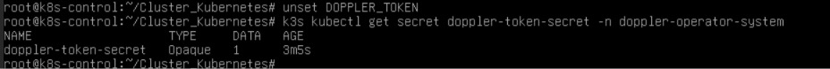

### 8.6 Aplicación de los secretos de Doppler

La salida confirma que los secretos de Doppler fueron aplicados correctamente
en Kubernetes. La aplicación puede consumirlos sin que sus valores queden
expuestos en los manifiestos del clúster.

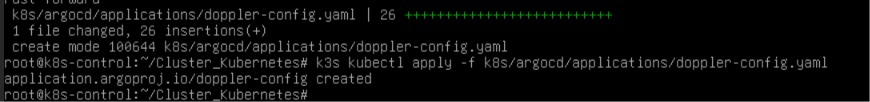

## 9. Validación de PostgreSQL

### 9.1 Credenciales de PostgreSQL en Doppler

La captura muestra las credenciales de PostgreSQL almacenadas en Doppler.
Esto confirma que los datos sensibles de conexión están centralizados y
disponibles para el despliegue autorizado de la base de datos.

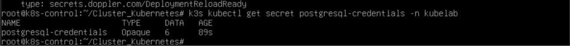

### 9.2 Verificación de las credenciales de PostgreSQL

La verificación confirma que PostgreSQL recibe y utiliza correctamente las
credenciales administradas por Doppler. Esta comprobación valida la conexión
entre el gestor de secretos y la aplicación de base de datos.

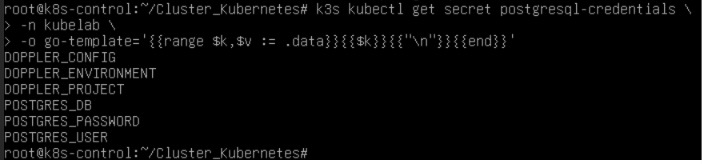

### 9.3 Persistencia de PostgreSQL

La captura muestra PostgreSQL funcionando con almacenamiento persistente.
Esto garantiza que los datos de la base de datos se conserven aunque el pod
sea reiniciado o recreado.

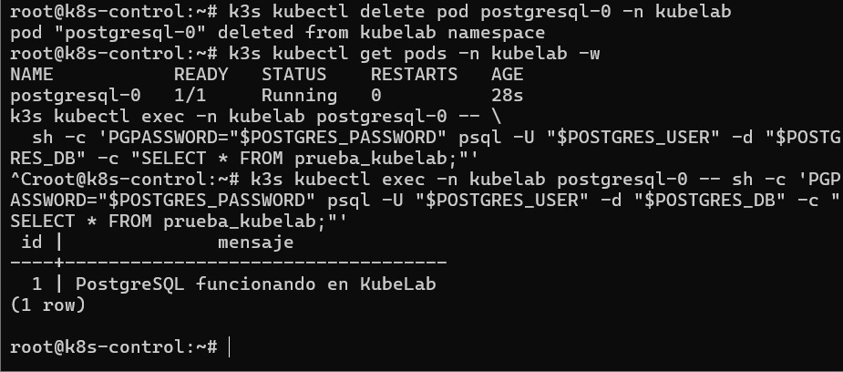

### 9.4 Acceso mediante port forwarding

El reenvío de puertos permite acceder temporalmente al servicio de PostgreSQL
desde el entorno local para realizar comprobaciones. Esta técnica facilita la
validación del servicio sin exponerlo permanentemente fuera del clúster.

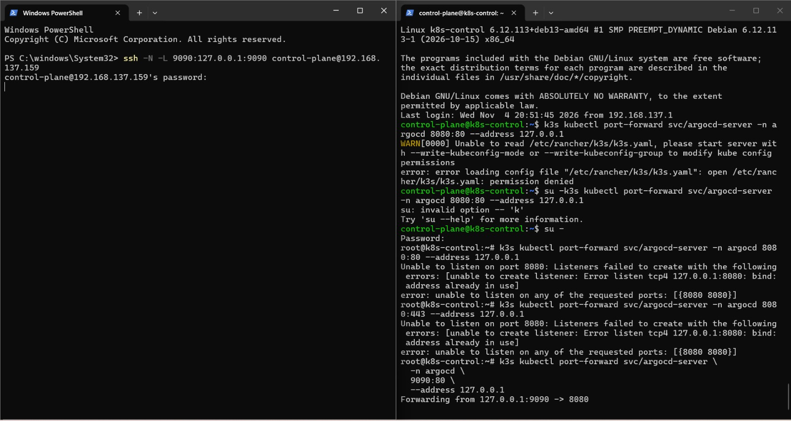

### 9.5 Sincronización de PostgreSQL

La captura confirma la sincronización de PostgreSQL con la configuración
definida para la aplicación. Esta validación demuestra que la base de datos
está integrada correctamente con los secretos y el almacenamiento del
clúster.

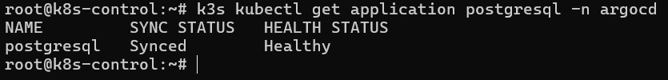

## 10. Despliegue de la API y operaciones con PostgreSQL

### 10.1 Imagen de contenedor y servicios de la API

La captura muestra la imagen de contenedor de la API y los servicios
relacionados con su despliegue. Estos elementos permiten preparar la aplicación
para ejecutarse y comunicarse dentro del clúster.

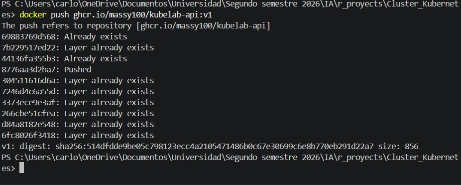

### 10.2 Validación de los manifiestos

La salida muestra la validación de los manifiestos de Kubernetes antes de su
aplicación. Esta comprobación ayuda a detectar errores de configuración en los
recursos declarados.

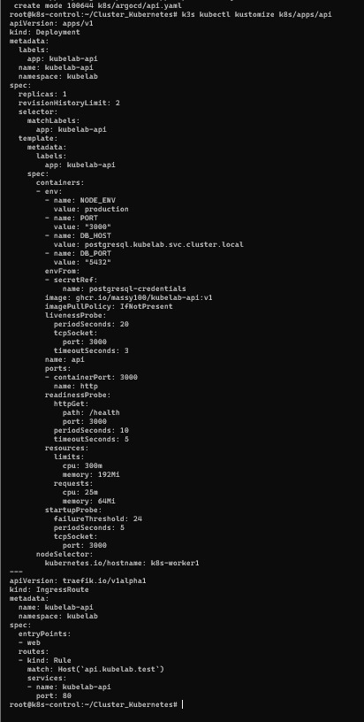

### 10.3 Aplicaciones de Argo CD

La vista de Argo CD muestra las aplicaciones registradas para su despliegue.
Permite revisar su estado y confirmar que están bajo la gestión del flujo
GitOps configurado.

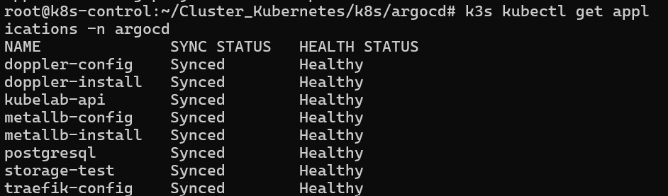

### 10.4 Pods administrados por Argo CD

La captura muestra los pods asociados a las aplicaciones de Argo CD y su estado
en Kubernetes. Esta revisión permite comprobar los recursos creados durante el
despliegue.

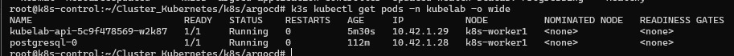

### 10.5 Estado de los servicios

La salida presenta los servicios creados para la aplicación y sus datos de
acceso. Esta información permite verificar cómo se exponen los componentes
dentro del clúster.

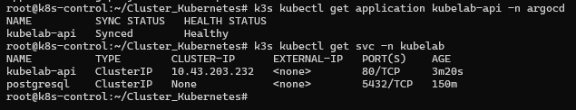

### 10.6 Conexión con la base de datos

La captura muestra la comprobación de conectividad entre la aplicación y
PostgreSQL. Esta prueba permite validar que la API puede comunicarse con la
base de datos configurada.

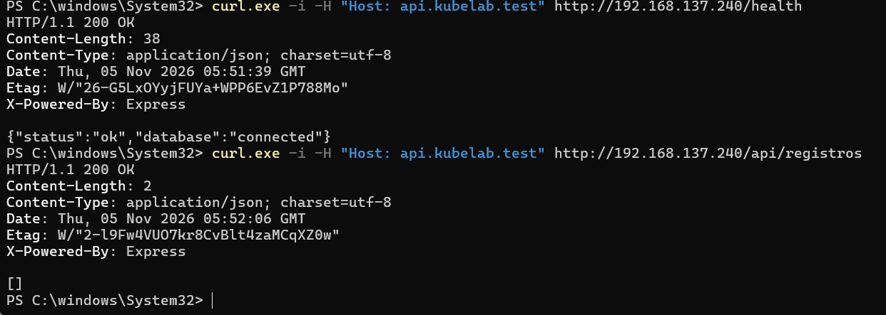

### 10.7 Prueba del servicio de la API

La solicitud de prueba permite comprobar que el servicio de la API responde
desde el clúster. Es una verificación inicial de que el endpoint está
disponible.

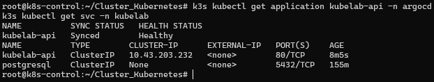

### 10.8 Inserción de datos en PostgreSQL

La captura muestra una operación de inserción enviada desde PowerShell para
crear un registro en PostgreSQL mediante la API.

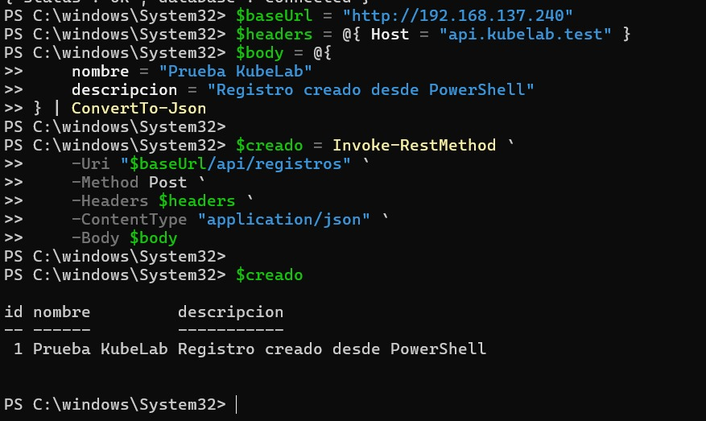

### 10.9 Consulta de datos con GET

La solicitud `GET` permite recuperar datos a través de la API y verificar que
los registros están disponibles para su lectura.

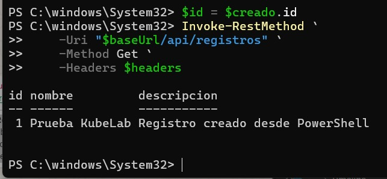

### 10.10 Consulta directa de registros

La captura muestra la consulta de los registros almacenados en PostgreSQL,
como comprobación de los datos disponibles en la base de datos.

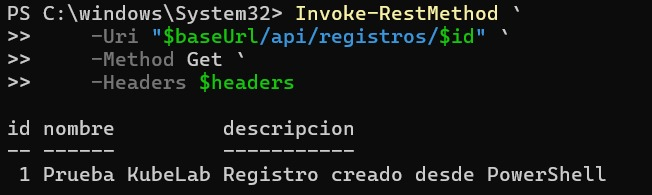

### 10.11 Actualización de datos con PUT

La solicitud `PUT` muestra la actualización de un registro existente mediante
la API.

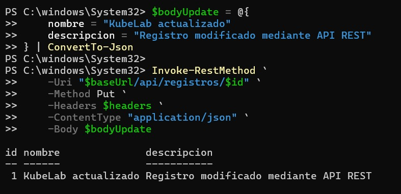

### 10.12 Verificación de la actualización

La consulta posterior a la operación `PUT` permite comprobar que los cambios
se guardaron en PostgreSQL.

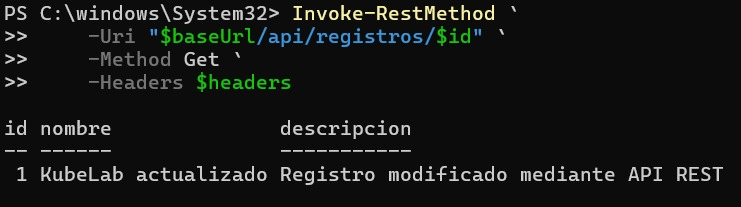

### 10.13 Eliminación y confirmación de datos

La captura muestra la eliminación de un registro y la comprobación posterior
de que ya no aparece en los resultados.

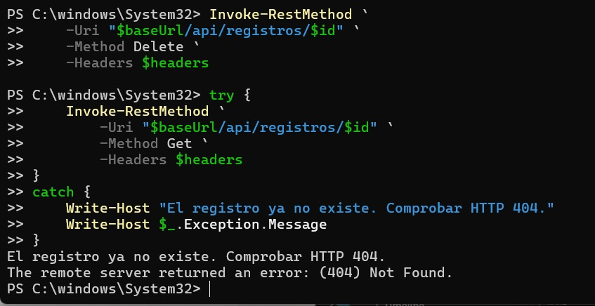

## 11. Despliegue de Kubelab y flujo CI/CD

### 11.1 Interfaz de Kubelab

La captura muestra la interfaz web de Kubelab, desde la que se accede a las
funciones de la aplicación.

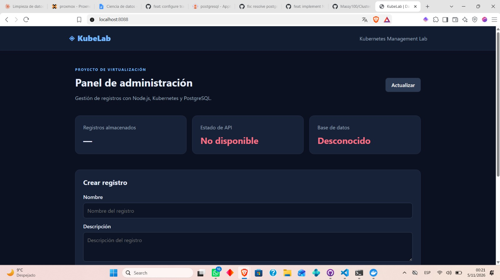

### 11.2 Despliegue de la Web API

La salida muestra el despliegue de la Web API en Kubernetes y los recursos
asociados a su puesta en marcha.

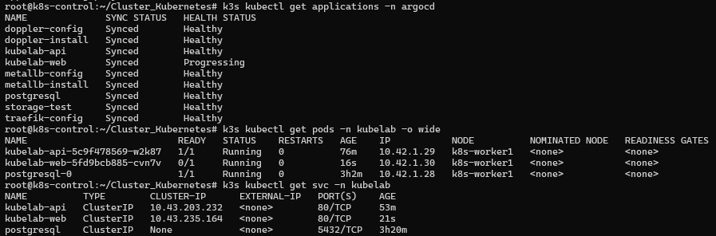

### 11.3 Verificación de la Web API

La captura muestra la Web API funcionando después del despliegue, como
comprobación de que la aplicación está disponible.

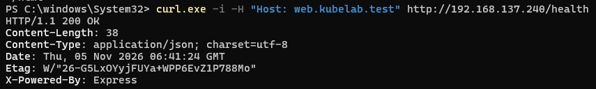

### 11.4 Servicios de Kubelab

La salida presenta los servicios de Kubelab en ejecución y permite verificar
los puntos de acceso configurados para la aplicación.

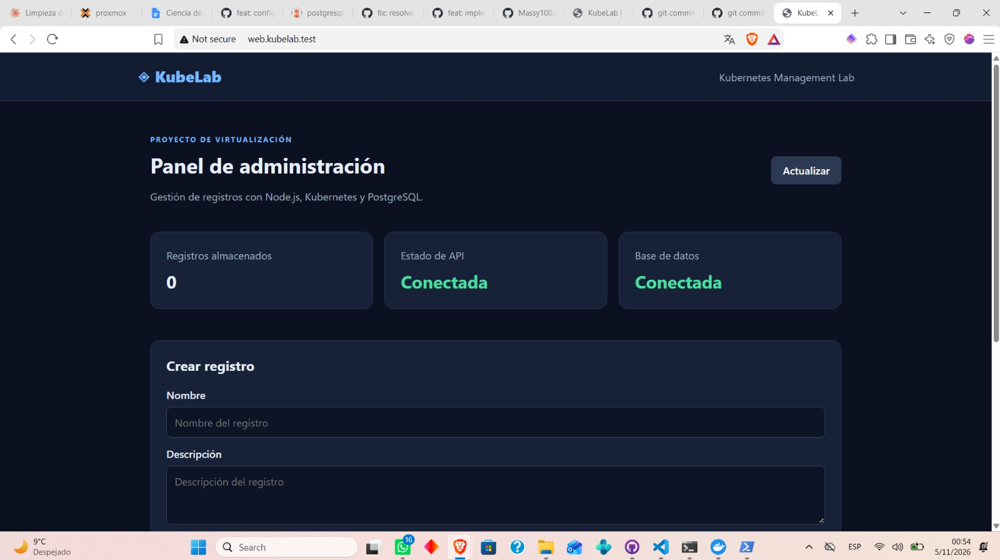

### 11.5 Despliegue mediante CI/CD

La captura muestra la ejecución del proceso de despliegue CI/CD para publicar
la aplicación en el clúster.

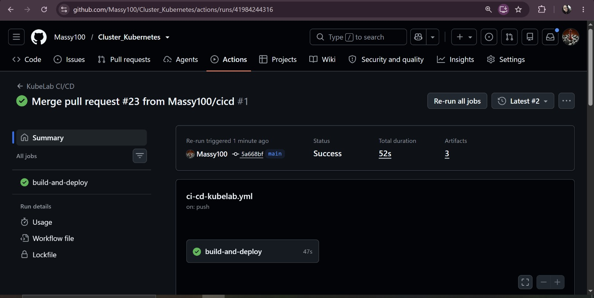

### 11.6 Pods después del despliegue

La verificación muestra los pods existentes después del despliegue CI/CD y
permite revisar su estado en Kubernetes.

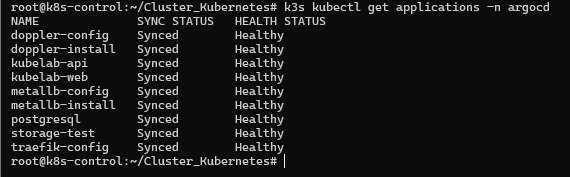

## 12. Monitoreo con Prometheus y Grafana

### 12.1 Pods de Prometheus

La captura muestra los pods de Prometheus y permite verificar el estado de los
componentes de monitoreo desplegados en Kubernetes.

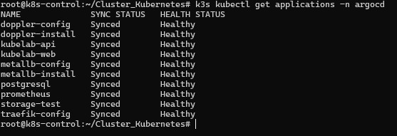

### 12.2 Interfaz de Prometheus

La interfaz de Prometheus permite consultar el estado del sistema de monitoreo
y explorar las métricas recopiladas.

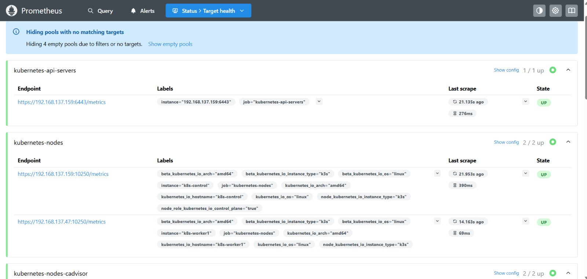

### 12.3 Monitoreo de la API

La captura muestra métricas asociadas a la Web API en Prometheus, para revisar
su actividad y comportamiento.

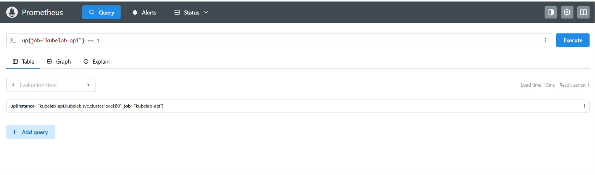

### 12.4 Tráfico de la Web API y del sitio web

La visualización presenta métricas de tráfico de la Web API y del sitio web,
útiles para observar las solicitudes recibidas por los servicios.

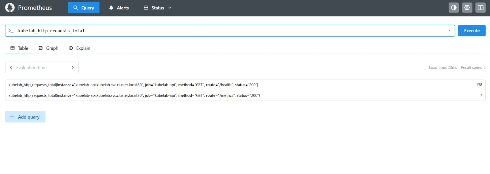

### 12.5 Estado de los pods y acceso a Grafana

La primera captura permite revisar el estado de salud de los pods asociados a
Grafana.

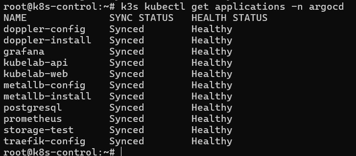

La segunda captura verifica la dirección IP y el puerto configurados para
acceder a Grafana.

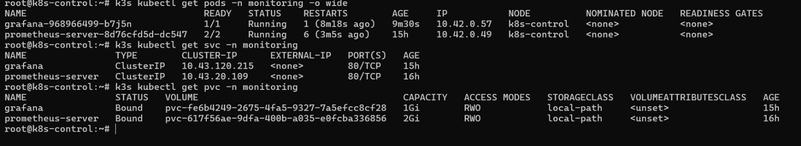

### 12.6 Paneles de Grafana

El panel de Grafana presenta las métricas recopiladas para facilitar la
supervisión visual del clúster y sus aplicaciones.

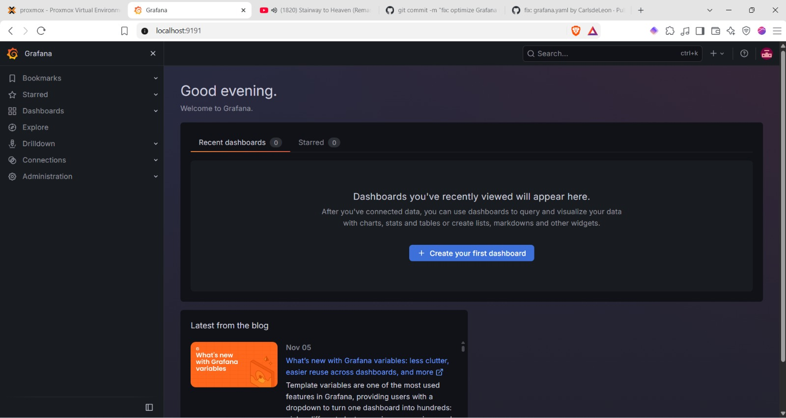

### 12.7 Integración de Grafana con Prometheus

La captura muestra la configuración de Prometheus como fuente de datos de
Grafana, necesaria para consultar y visualizar sus métricas desde los paneles.

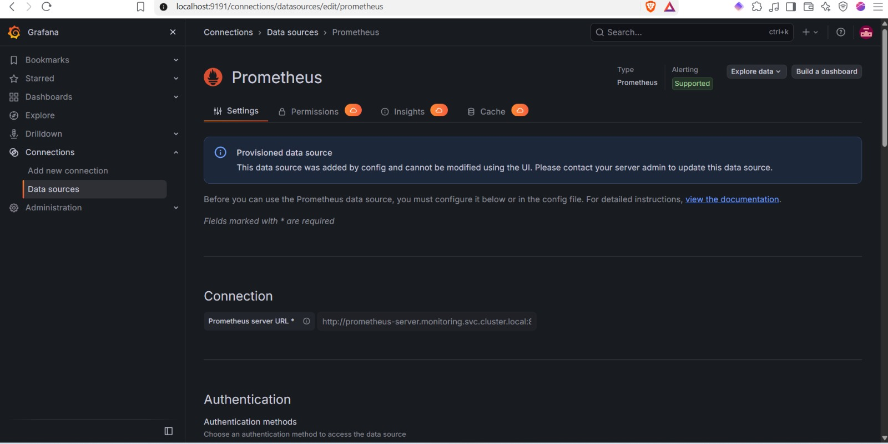

### 12.8 Conexión de la API de Kubelab

La captura muestra la conexión de Kubelab con su API, como parte de la
integración entre la interfaz y el servicio de backend.

### 12.9 Métricas de Kubelab

La vista presenta las métricas disponibles para Kubelab y permite inspeccionar
la información expuesta por la aplicación para su monitoreo.

### 12.10 Visualización de consultas

La captura muestra la visualización de consultas de métricas en Kubelab,
permitiendo revisar los resultados obtenidos desde la interfaz.

### 12.11 Paneles adicionales y validación de consultas

El primer panel muestra una visualización adicional de las métricas en
Grafana.

El segundo panel presenta otra vista de las métricas disponibles en Grafana.

La última captura permite comprobar el estado de los pods después de ejecutar
consultas en los paneles.

## 13. Recolección y consulta de logs con Loki

### 13.1 Estado del pod de Loki

La captura muestra el pod de Loki en estado saludable y sincronizado, como
verificación del componente de almacenamiento y consulta de logs.

### 13.2 Integración de Grafana con Loki

La captura muestra la integración de Loki en Grafana para consultar y explorar
los registros desde la interfaz de monitoreo.

### 13.3 Pod de Alloy

La salida confirma la creación del pod de Alloy, componente utilizado en este
entorno para recopilar y enviar registros hacia Loki.

### 13.4 Consulta de logs

La captura muestra registros consultados desde Loki, como comprobación del
flujo de recolección y visualización de logs.

## 14. Escalado automático de la aplicación

### 14.1 HPA con una réplica

La captura muestra el estado inicial del Horizontal Pod Autoscaler (HPA) con
una réplica de la aplicación, que sirve como referencia antes de aumentar la
carga.

### 14.2 Uso de CPU de la primera réplica

La visualización muestra el consumo de CPU de la primera réplica durante la
prueba de carga.

### 14.3 HPA con dos réplicas

La captura muestra dos réplicas de la aplicación después de que el HPA ajusta
la cantidad de pods en respuesta a la carga.

### 14.4 Reescalado ante exceso de CPU

La evidencia muestra el reescalado de la aplicación al superar el umbral de
uso de CPU configurado. Esto permite comprobar la respuesta automática del HPA
ante un aumento de demanda.

### 14.5 Verificación de pods

La salida permite comprobar el estado de los pods después de la prueba de
escalado.

## 15. Acceso remoto y disponibilidad de las aplicaciones

### 15.1 Acceso mediante datos móviles

La captura muestra el acceso remoto al entorno utilizando una conexión de
datos móviles, como prueba de disponibilidad fuera de la red local.

### 15.2 Conectividad con los nodos

La prueba de conectividad muestra respuestas desde el control plane y Worker 1,
verificando que ambos nodos son alcanzables desde el entorno remoto.

### 15.3 Aplicaciones disponibles desde acceso remoto

La captura muestra las aplicaciones accesibles mediante la conexión remota,
como comprobación de su disponibilidad desde fuera de la red local.

### 15.4 Estado de los pods durante el acceso remoto

La salida muestra los pods saludables y sincronizados mientras se valida el
acceso remoto a las aplicaciones.

### 15.5 Conexión remota a los puertos

La captura muestra la conexión remota a los puertos publicados para acceder a
los servicios del clúster.

### 15.6
En esta captura se muestra el dashboard de grafana, luego de realizar un cambio de dominio
