# Configuración del laboratorio de Proxmox y Kubernetes

Este documento registra la instalación y validación de un entorno pequeño de
Kubernetes alojado en Proxmox VE. El laboratorio contiene un host de Proxmox,
una máquina virtual para el control plane de Kubernetes y tres máquinas
virtuales worker.

## 1. Instalación de Proxmox VE

El resumen del instalador de Proxmox VE confirma el disco de destino, el
sistema de archivos, la configuración regional, la zona horaria, la interfaz
de administración, el nombre del host, la dirección IP estática, la puerta de
enlace y el DNS antes de iniciar la instalación. El reinicio automático está
habilitado para que el host se reinicie cuando finalice la instalación.

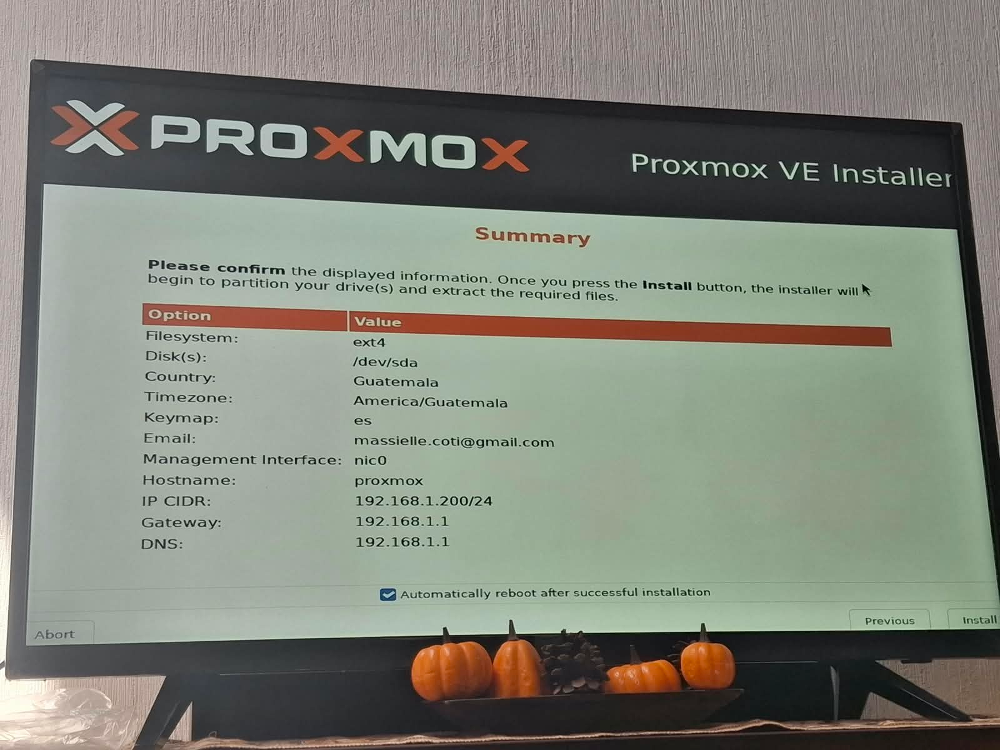

Después de la instalación, la consola de Proxmox muestra la URL de
administración. Esta consola confirma que el host se inició correctamente y
está listo para administrarse mediante la interfaz web.

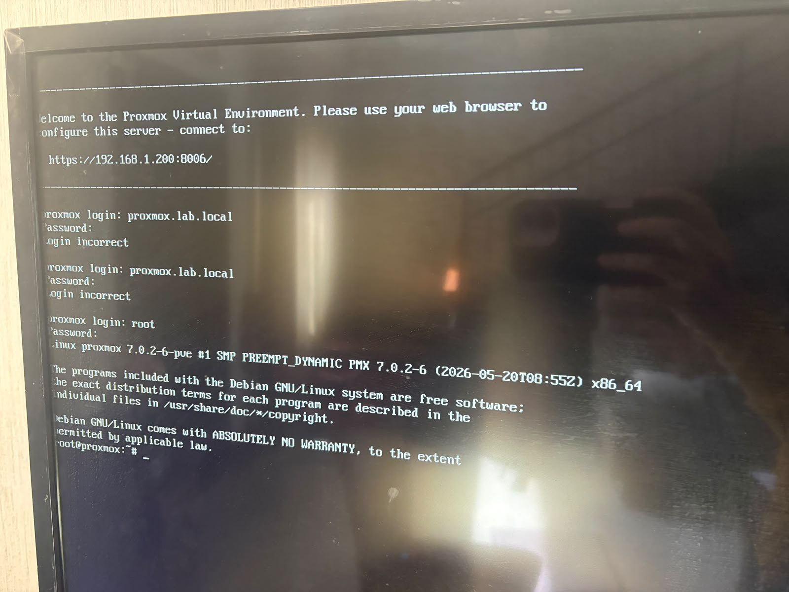

## 2. Configuración de red de Proxmox

Los comandos `ip -br link` e `ip -br addr` muestran el estado de las
interfaces del host. La interfaz física está conectada al puente de Proxmox y
el puente tiene la dirección IPv4 del host. Esto verifica que el host cuenta
con conectividad de red para la administración y las máquinas virtuales.

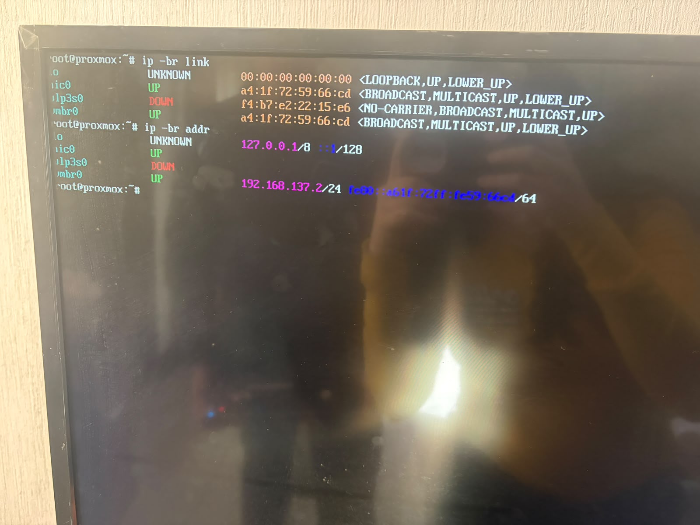

## 3. Interfaz web de Proxmox y almacenamiento de máquinas virtuales

La interfaz web de Proxmox proporciona la vista central de administración del
datacenter. Muestra el nodo de Proxmox, el puente de red, los almacenes y el
uso actual de recursos, lo que confirma que el host está visible y puede
administrarse.

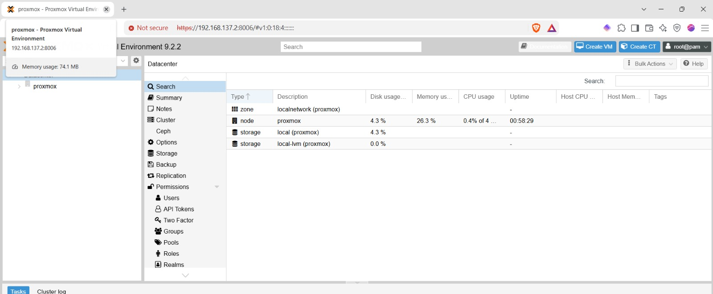

La vista de almacenamiento muestra el almacén `local` y su capacidad
disponible. También muestra la máquina virtual del control plane y registra
tareas recientes, como la creación de la máquina virtual, la copia de datos y
su inicio.

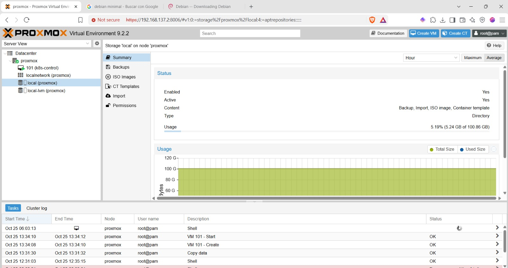

## 4. Máquina virtual del control plane

La consola del control plane muestra Debian GNU/Linux 13 ejecutándose en la
máquina virtual `k8s-control`. El inicio de sesión correcto y el indicador de
comandos confirman que el sistema operativo está instalado y que la máquina
virtual es accesible desde la consola de Proxmox.

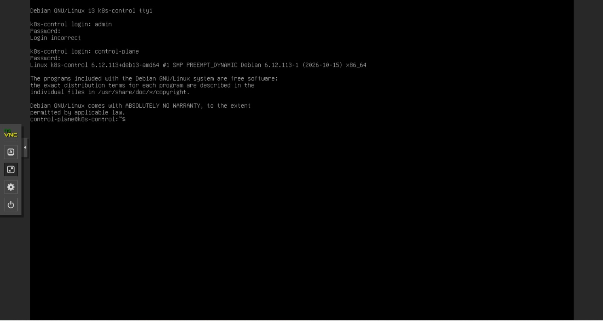

### 4.1 Conectividad del control plane

La terminal del control plane muestra primero la información de red del
nodo y después ejecuta `apt update`. Las respuestas correctas de los
repositorios y el resultado final actualizado verifican que la máquina virtual
puede acceder a los repositorios de paquetes de Debian.

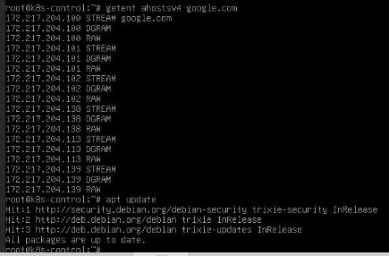

### 4.2 Servicios de Kubernetes del control plane

Las métricas del control plane muestran las cargas de trabajo de Kubernetes
ejecutándose en el espacio de nombres `kube-system`, incluidos CoreDNS, el
servidor de métricas, el provisionador de rutas locales y Traefik. La salida
también muestra la dirección IPv4 del nodo y las interfaces Flannel y CNI
utilizadas para la red de los pods.

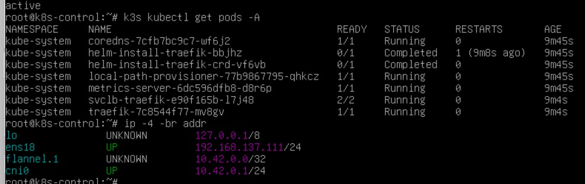

## 5. Máquina virtual Worker 1

La consola de Worker 1 muestra Debian GNU/Linux 13 ejecutándose en la máquina
virtual `k8s-worker1`. El inicio de sesión correcto y el indicador de comandos
confirman que el sistema operativo del worker está disponible para configurarlo
con Kubernetes.

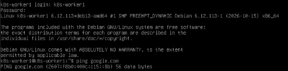

### 5.1 Conectividad de red de Worker 1

La terminal del worker utiliza `ping google.com` para probar la conectividad
externa. El comando resuelve el nombre de host y comienza a recibir
respuestas ICMP, lo que confirma que Worker 1 puede acceder a la red.

### 5.2 Instalación de Kubernetes en Worker 1

La salida del estado de Kubernetes muestra el nodo del control plane en
estado `Ready` y los pods del sistema de Kubernetes ejecutándose en Worker 1.
La salida también muestra la dirección IPv4 interna del worker, la interfaz
Flannel y la interfaz CNI, lo que confirma que el nodo se unió al clúster y
que tiene configurada la red de pods.

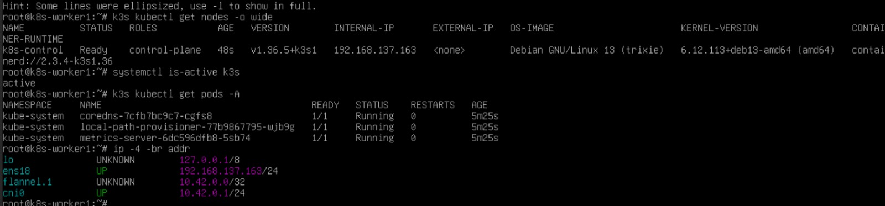

## 6. Memoria del host y asignación de máquinas virtuales

La salida de los comandos `free -h`, `swapon --show` y `qm list` valida la
asignación de recursos del host desde la línea de comandos. Muestra la memoria
total y disponible, el espacio swap activo y las cuatro máquinas virtuales en
ejecución, junto con la memoria y el tamaño de disco de arranque asignados.

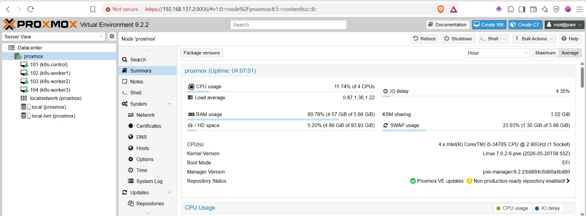

## 7. Validación final de los cuatro nodos

El árbol de nodos de Proxmox confirma que la máquina virtual del plano de
control y las tres máquinas virtuales worker están ejecutándose
simultáneamente. Esta es la comprobación final de la infraestructura antes de
utilizar el clúster de Kubernetes.

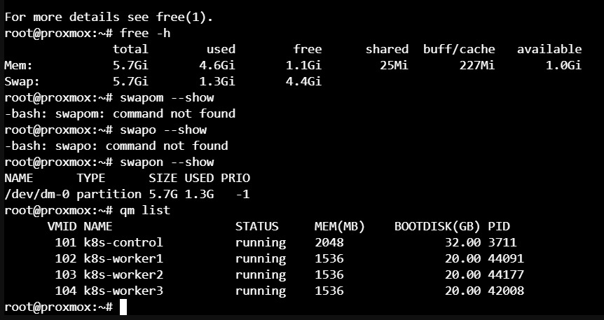
